# HW 3 - Procedural Jellyfish

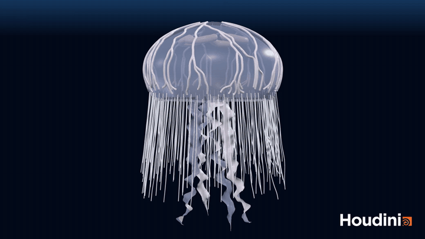

Full clip (viewport flipbook, 144 frames at 24 fps): [Screenshots/jellyfish.mp4](Screenshots/jellyfish.mp4)

Scene is `jellyfish.hipnc` (Houdini 22.0.466 Apprentice, hence the watermark), submitted on Canvas. Everything is inside `/obj/jellyfish`, one column of nodes per part, with the sliders on a `controls` null at the front. No caches, the tentacle sim just runs from frame 1.

| 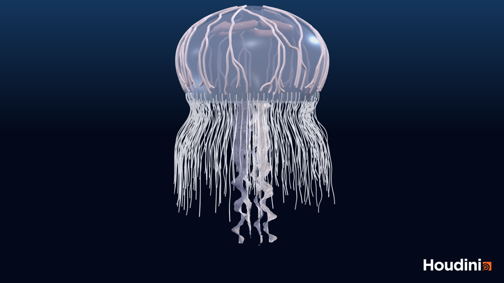 | 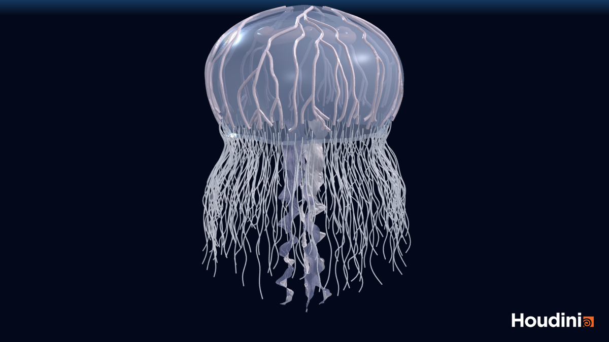 |
|:--:|:--:|
| 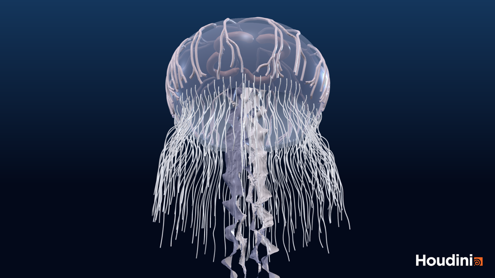 | 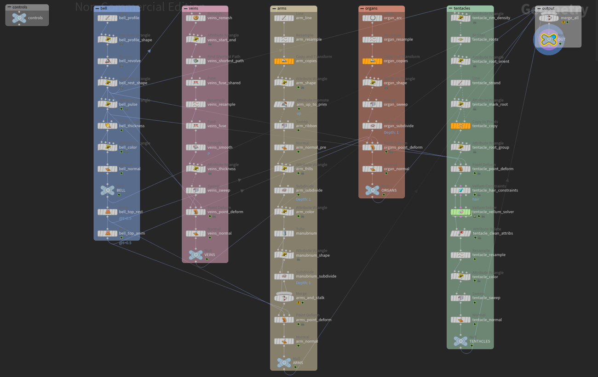 |

## Bell

A `line` bent into a profile curve in a wrangle, then `revolve`. The profile is `r = R sin(a)`, `y = RH cos(a)` with `a` going a bit past 90° so the rim curls under. The wrangle also writes `@t` (0 at the apex, 1 at the rim), which drives pretty much everything else: the pulse, the scallops, where the veins stop, where the tentacles grow.

A second wrangle adds a scalloped rim (`cos(8 theta)` weighted by `t^5`) and some puckering noise, then `polyextrude` gives it thickness. `@Alpha = 0.45` makes it translucent in the viewport.

| 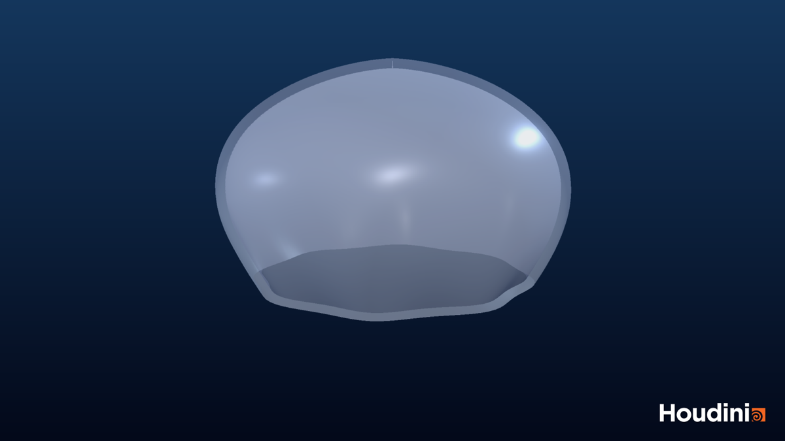 | 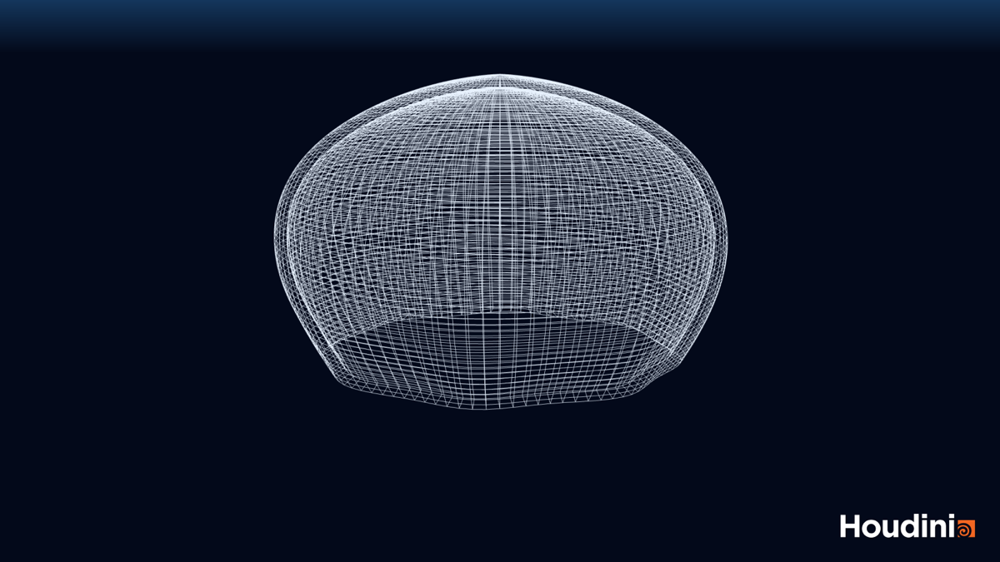 |
|:--:|:--:|

**Pulse.** One wrangle on `@Time`. The phase is `frac(Time / period - lag * t)`, so the contraction starts at the apex and travels to the rim. The curve is asymmetric (fast `smooth` in, slow out), it scales x/z by `1 - amount * c * t^1.5`, adds a little noise wobble, and the whole bell bobs up with a cosine offset from the contraction.

## Veins

The shortest path recipe from the writeup, on the static bell:

- `remesh` to triangles (0.04)
- wrangle: `starts` = random points on a small ring around the apex, `ends` = random points with `0.86 < t < 0.94`, plus a noisy `@cost`
- `findshortestpath`, "From any start to each end", with `cost` as the point cost. The noise is what makes them wander and branch; overlapping routes near the top give the tree for free
- `fuse`, `resample`, `fuse`, `smooth`
- `pscale` tapering from apex to rim, `sweep` as a tube
- `pointdeform` from the static bell to the pulsing one

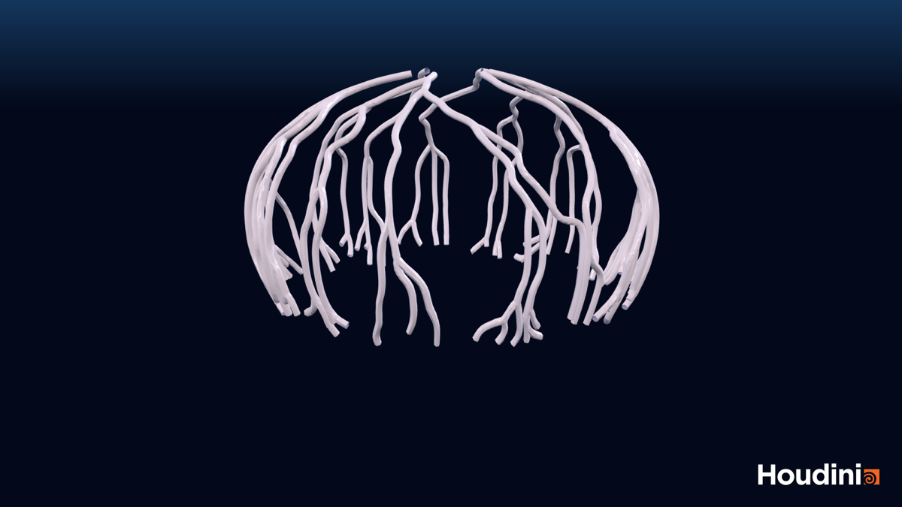

## Arms

Four `line`s copied with `copyxform`, shaped in a wrangle (angle from prim number, flare outward, slow noise sway on `@Time`, `pscale` narrowing to the tip), swept as a ribbon with 200° of twist. The frills are a wrangle after the sweep: `sin(55u)` along the normal, scaled by how far the point is from the ribbon's centre line (`|side|^1.5`), so only the edges ruffle. One `subdivide` after that. They hang off a short noisy `tube` as the manubrium.

The arms, stalk and organs are point deformed to the *top half* of the bell only (`blast @t>0.5` on both rest and animated). Deforming to the whole bell captured rim points and squeezed them every pulse.

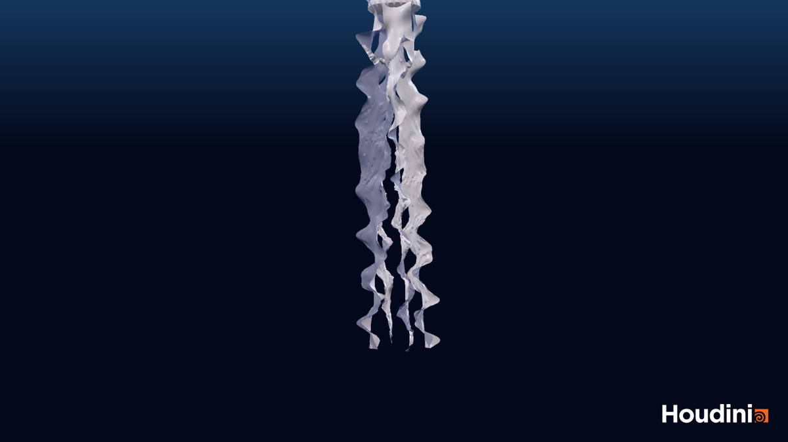

## Organs

Moon jelly style: four horseshoes. A `circle` open arc (-105° to 105°) offset from centre, `copyxform` x4 at 90°, a wrangle to sit them just under the dome (same `cos(asin(r/R))` as the bell profile) and make them lumpy, `sweep` with round caps, `subdivide`.

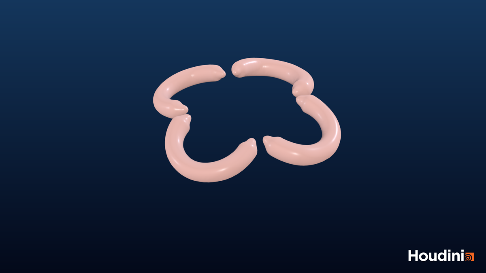

## Tentacles

What I took from the hair tutorial: grow curves from points, Vellum Constraints in Hair mode, pin the roots, solve. The jellyfish part is making the roots follow the animated rim:

1. `scatter` 170 points on the static bell with density `smooth(0.9, 1, t)`
2. wrangle for `N` (down, slight outward tilt), `up`, random `pscale` for length
3. `copytopoints` a 16 point line. The template line has `@root = 1` on its first point, which becomes the `roots` group. A bit of noise per strand so they don't rest as straight rods
4. `pointdeform` the strands to the pulsing bell, so the solver's input is already animated
5. `vellumconstraints` Hair, Pin Points `roots`, Match Animation on, bend stiffness 2e-5
6. `vellumsolver`, gravity -0.5, built-in wind at zero speed with drag 1.5 as water drag
7. `attribdelete` the solver attributes, `resample` as subd curves, `sweep` thin tube

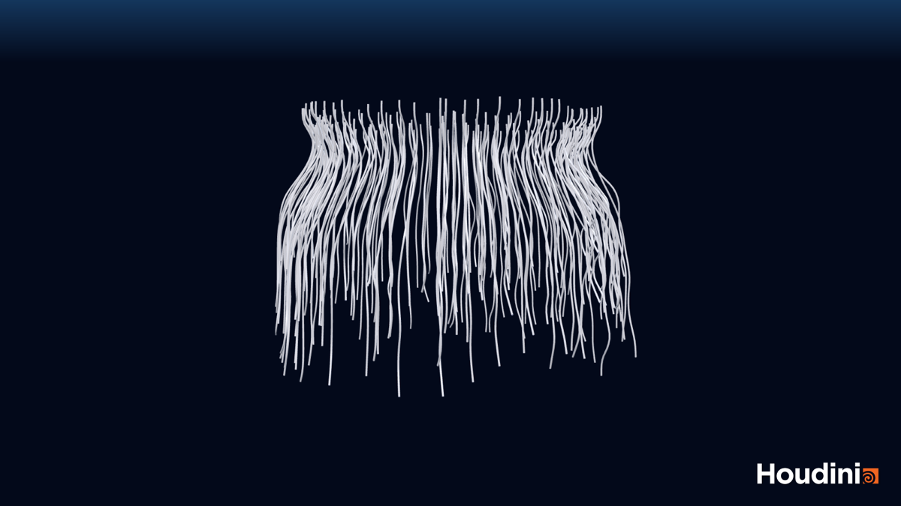

## Controls

All on the `controls` null, referenced with `ch("../controls/...")`.

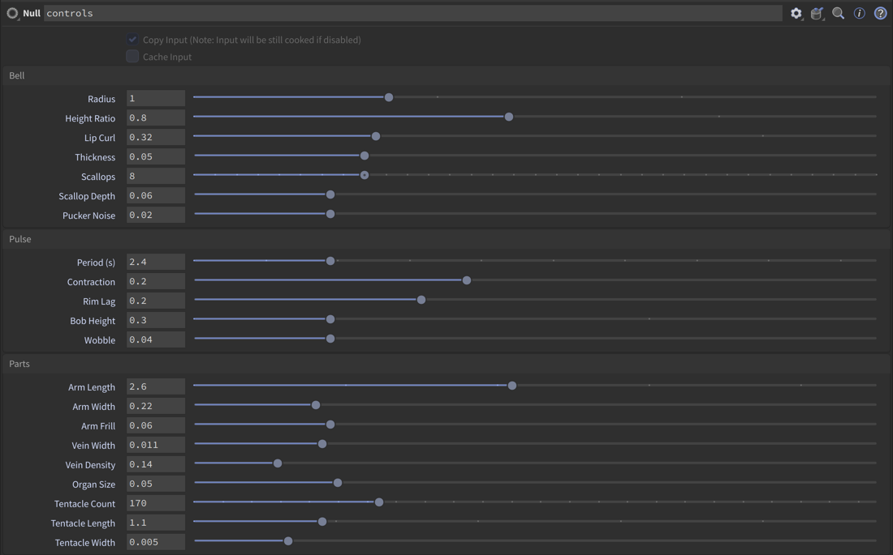

## Extras

- Scalloped, puckered rim and real thickness on the bell
- The manubrium stalk the arms hang from
- Three distant lights + ambient in the scene, flipbook with high quality lighting, gradient background composited with ffmpeg

## Things that bit me

- `copyxform`'s copy number attribute was 0 for every copy, so I use `@primnum`
- The viewport draws a UV checker on anything with uvs and no material. Turned Compute UVs off on the revolve
- Sweep: `pscale` needs "Transform Using Curve Point Attributes", the up vector has to be a primitive attribute, and the vellum solver leaves a tiny `pscale` behind that shrank my tentacles to hairlines
